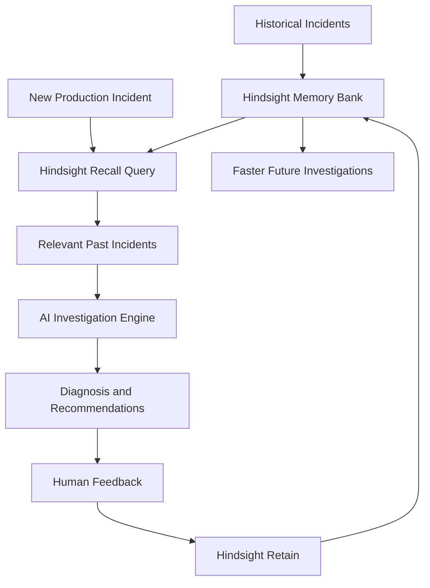

# 🔍 IncidentLens
### Don't investigate the same incident twice.

**IncidentLens** is an autonomous, learning-first incident investigation platform powered by **Hindsight persistent organizational memory**.

It transforms how engineering teams investigate production incidents by remembering previous outages, recalling relevant diagnostic experiences, identifying recurring failure patterns, and learning from human feedback.

Instead of investigating every incident from scratch, IncidentLens uses organizational memory to help engineers reach faster, evidence-grounded resolutions.

**Built for the hackathon: AI Agents That Learn Using Hindsight.**

<p align="center">

  🚀 **[Live Demo](https://incident-memory.vercel.app/dashboard)**

</p>

---

## 🎯 The Problem

Production incidents often repeat, but engineering teams frequently investigate them as if they were happening for the first time.

- Previous incident resolutions are easily forgotten.
- Engineers spend valuable time repeating diagnostic investigations.
- Organizational knowledge is scattered across logs, tickets, and conversations.
- AI investigation systems often lack persistent organizational learning.
- Lessons from resolved incidents are not consistently reused.

## 💡 Our Solution

IncidentLens introduces a persistent organizational memory layer into incident investigation.

It connects current production telemetry with historical incident experiences using Hindsight.

The system:

1. **Remembers:** Stores historical incidents, diagnostic corrections, and confirmed resolutions.
2. **Recalls:** Retrieves relevant past incidents when a new outage occurs.
3. **Reasons:** Combines current telemetry with historical evidence to generate a diagnosis.
4. **Learns:** Uses human feedback to reinforce existing patterns and retain new knowledge.
5. **Improves:** Makes future investigations more informed through accumulated organizational experience.

---

## ⚡ The Virtuous Memory Cycle

Every investigation contributes to organizational intelligence.



**The key idea:** Every resolved incident becomes valuable experience for the next investigation.

---

## 🌟 Key Features

### 1. Persistent Organizational Memory
- Integrated with the official Hindsight SDK (`hindsight-client`).
- Uses the memory bank `incidentlens-production`.
- Retains historical incidents, resolutions, and diagnostic learnings.
- Supports semantic recall of relevant incident experiences.

### 2. Intelligent Incident Investigation
- Analyzes current incident telemetry.
- Retrieves similar historical incidents.
- Combines current evidence with previous diagnostic experiences.
- Generates diagnosis, confidence scores, and recommended resolutions.

### 3. Human-in-the-Loop Learning
- Engineers can confirm or correct AI-generated diagnoses.
- Feedback reinforces existing diagnostic patterns.
- New investigation outcomes are retained in Hindsight.
- Organizational knowledge improves with every confirmed incident.

### 4. Graceful Degradation
- Supports live Hindsight Cloud integration.
- Provides grounded local memory when Hindsight credentials are unavailable or the service is offline.
- Prevents the application from depending entirely on external memory availability.

### 5. Duplicate Prevention
- Idempotent incident seeding.
- Duplicate memory prevention.
- Repeated investigations do not unnecessarily duplicate memory records.

---

## 🖥️ Application Preview

The IncidentLens Command Center provides a unified interface for monitoring incidents, investigating failures, and tracking organizational learning.

### Main Modules

| Module | Description |
|---|---|
| Dashboard | Overview of active incidents, historical incidents, and learned patterns. |
| Investigation Workspace | AI-powered incident analysis and diagnosis. |
| Hindsight Recall | Displays relevant historical incidents retrieved from memory. |
| Learning Dashboard | Tracks confirmed patterns and organizational learning. |
| Memory Explorer | Provides visibility into retained organizational memories. |

**Application Screenshots:**

Add your actual application screenshots here.

```text
docs/
├── dashboard.png
├── investigation.png
├── hindsight-recall.png
└── learning-dashboard.png
```

Example:

```markdown

```

---

## 🏗️ System Architecture

IncidentLens follows a modern full-stack architecture.

| Layer | Technologies |
|---|---|
| Frontend | TanStack Start, React 19, Vite |
| Styling | Tailwind CSS v4 |
| Icons | Lucide React |
| Backend | FastAPI, Python |
| Database | SQLite, SQLAlchemy |
| Validation | Pydantic v2 |
| Memory Engine | Hindsight |
| SDK | hindsight-client |
| AI Investigation | Grounded domain reasoning + optional LLM synthesis |

### Architecture Overview

```text
                 INCIDENTLENS
                       |
          +------------+------------+
          |                         |
       FRONTEND                  BACKEND
          |                         |
     React 19                  FastAPI
     TanStack Start                 |
     Tailwind CSS             Investigation API
          |                         |
          |              +----------+----------+
          |              |          |          |
          |           SQLite    Hindsight    AI Engine
          |           Database   Memory       |
          |                       Bank     Reasoning
          |                         |
          +------------+------------+
                       |
                Investigation Report
                       |
                 Human Feedback
                       |
                Memory Retention
```

---

## 📂 Project Structure

```text
incident-memory-main/
│
├── backend/
│   ├── app/
│   │   ├── api/              # FastAPI REST endpoints
│   │   ├── database/         # SQLite engine and sessions
│   │   ├── hindsight/        # Hindsight client integration
│   │   ├── investigation/    # Diagnostic reasoning and LLM synthesis
│   │   ├── models/           # SQLAlchemy ORM models
│   │   ├── schemas/          # Pydantic API schemas
│   │   ├── seed/             # Historical incidents and INC-104
│   │   ├── services/         # Business logic and statistics
│   │   ├── config.py         # Environment configuration
│   │   └── main.py           # FastAPI application
│   │
│   ├── tests/                # Pytest test suite
│   ├── .env.example          # Environment template
│   └── requirements.txt      # Python dependencies
│
├── frontend/
│   ├── src/
│   │   ├── components/       # UI components and Command Center
│   │   ├── context/          # Live state synchronization
│   │   ├── routes/           # Application routes
│   │   ├── services/         # Backend API client
│   │   └── types/            # TypeScript definitions
│   │
│   └── package.json
│
└── README.md
```

---

## 🚀 Getting Started

Follow these instructions to run IncidentLens locally.

### 1. Prerequisites

Make sure you have installed:

- Python 3.10+ (tested with Python 3.12)
- Node.js 20+ (tested with Node 24)
- npm
- Git

### 2. Clone the Repository

```bash
git clone YOUR_GITHUB_REPOSITORY_URL
cd incident-memory-main
```

### 3. Backend Setup

Navigate to the backend directory:

```bash
cd backend
```

Create a virtual environment:

```bash
python -m venv venv
```

Activate the virtual environment.

**Windows:**

```powershell
.\venv\Scripts\Activate.ps1
```

**Linux/macOS:**

```bash
source venv/bin/activate
```

Install dependencies:

```bash
pip install -r requirements.txt
```

Configure environment variables:

```bash
cp .env.example .env
```

For Windows PowerShell, you can also copy the file using:

```powershell
Copy-Item .env.example .env
```

Configure your Hindsight credentials in `.env` if you want to use live Hindsight Cloud integration.

Run the database seeder:

```bash
python -m app.seed
```

Run tests:

```bash
pytest -v
```

Start the backend server:

```bash
uvicorn app.main:app --reload --port 8000
```

Backend URL:

```text
http://localhost:8000
```

API Documentation:

```text
http://localhost:8000/docs
```

Health Check:

```text
http://localhost:8000/api/health
```

### 4. Frontend Setup

Open another terminal and navigate to the frontend directory:

```bash
cd frontend
```

Install dependencies:

```bash
npm install
```

Start the development server:

```bash
npm run dev
```

Frontend URL:

```text
http://localhost:3000
```

Depending on the Vite configuration, the development server may use:

```text
http://localhost:5173
```

---

## 🧠 Hindsight Integration

IncidentLens uses Hindsight as its persistent organizational memory engine.

### Configuration

1. Sign up or log in to Hindsight.
2. Generate an API key.
3. Open `backend/.env`.
4. Configure the following variables:

```env
HINDSIGHT_API_KEY=your_actual_api_key_here
HINDSIGHT_BASE_URL=https://api.hindsight.vectorize.io
HINDSIGHT_BANK=incidentlens-production
```

5. Restart the backend.

```bash
uvicorn app.main:app --reload --port 8000
```

When configured successfully, the application can connect to the Hindsight Cloud memory bank.

When live credentials are unavailable, IncidentLens can use its built-in grounded local memory fallback.

---

## 🎬 60-Second Demo Walkthrough

Experience how IncidentLens investigates and learns from a production incident.

### Step 1: Command Center

Open `/dashboard`.

Observe:

- 1 active incident (INC-104).
- 10 historical incidents.
- 4 learned patterns.
- 10 Hindsight memories.

Review the incident telemetry:

- Error rate: 18.4%.
- Database connection exhaustion: 98%.

Click **Investigate**.

### Step 2: Investigation Workspace

Open `/investigate`.

Click **Run Investigation**.

The investigation pipeline:

1. Analyzes current incident evidence.
2. Recalls relevant organizational memories.
3. Matches historical incidents.
4. Generates an evidence-grounded diagnosis.

### Step 3: Hindsight Recall

The investigation recalls three relevant historical incidents:

| Incident | Similarity | Historical Finding |
|---|---:|---|
| INC-031 | 96% | Connection pool exhausted after deployment |
| INC-052 | 89% | Leaked connections after release |
| INC-083 | 84% | Connection leak due to missing close() |

### Step 4: AI Investigation Report

The system generates:

**Diagnosis:** Database connection leak following recent deployment.

**Confidence:** 89%.

**Recommended Actions:**
- Verify database connection pool configuration.
- Investigate potential connection leaks.
- Consider rolling back the recent deployment.

### Step 5: Human Feedback

Click **Confirm Diagnosis**.

Add optional feedback, for example:

`Confirmed rollback resolved the connection pool saturation.`

Click **Save to Hindsight**.

### Step 6: Organizational Learning

Return to the dashboard and learning modules.

The expected demonstration state becomes:

- INC-104 marked as Resolved.
- Hindsight memories increase from 10 to 11.
- Confirmed outcomes increase from 10 to 11.
- Pattern PAT-01 increases from 3 to 4 confirmations.

The next investigation can benefit from the newly retained experience.

---

## 🧪 Testing & Verification

IncidentLens includes an automated backend test suite using Pytest.

Run the tests:

```bash
cd backend
pytest -v
```

The project test suite currently reports:

- 15 passing tests.
- Verification of core backend functionality.
- Coverage of important incident and memory workflows.

---

## 🔮 Future Enhancements

Potential future improvements include:

- Integration with real-time monitoring platforms.
- Automated incident detection and alerting.
- Support for additional observability tools.
- Advanced recurring incident prediction.
- Multi-team organizational memory.
- More sophisticated AI investigation agents.
- Automated incident resolution workflows.

---

## 🏆 Built For

**AI Agents That Learn Using Hindsight Hackathon**

IncidentLens demonstrates how persistent organizational memory can transform AI agents from one-time problem solvers into systems that continuously learn from experience.

**Our vision:** Every incident should make the next investigation smarter.

---

## 📜 License

This project is licensed under the MIT License.

---

<p align="center">

  **IncidentLens**

  Don't investigate the same incident twice.

  Built with ❤️ for smarter incident investigation.

</p>
